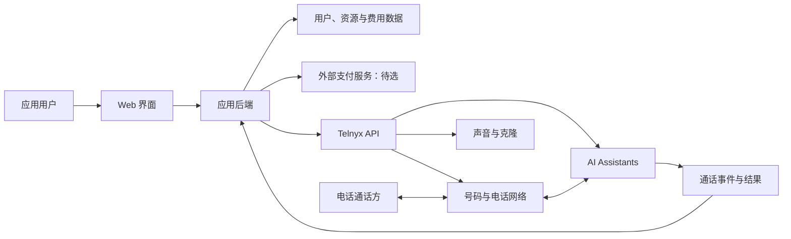

# Easy Voice — 产品与技术基础 Spec

版本：0.3

整理日期：2026-10-07

状态：已确认方针的开发基线；第 12 节待确定事项已于 v0.2 在第 16 节收敛为 MVP 决策；v0.3 根据真实来电测试更新模型组合。

## 1. 文档用途

本文整理当前讨论中已经确认的产品定位、能力范围和技术方针，作为后续需求细化、技术设计和开发的共同依据。

本文不是完整 PRD，也不表示已经完成供应商账号配置或真实电话验证。下文分别标识：

- **已确认**：用户已经明确接受的方向和范围。
- **实现约束**：为实现该方向所需的基本工程边界，不代表已选定实现技术。
- **待确定**：尚未讨论或验证的细节，开发时不得视为默认已批准的需求。

项目目录名用于本文标题，不表示已确定正式产品名称。

## 2. 产品定位与目标用户〔已确认〕

开发一个面向个人用户的 Web 服务，将外部平台已有的电话和 Voice Agent 能力整合进统一界面。

| 项目 | 结论 |
| --- | --- |
| 使用场景 | 个人语音助理 |
| 目标市场 | 美国 |
| 号码范围 | 优先美国号码；具体号码类型待确定 |
| 主要通话语言 | 英语和中文；中文具体语种待确定 |
| 产品形式 | 外部能力整合与界面封装，保持简单 |
| 核心供应商 | Telnyx |
| 当前目标 | 核心能力、用户系统及付费系统形成完整闭环 |

当前不研究商业化策略或产品差异化，也不围绕行业模板扩展需求。

## 3. 技术方针〔已确认〕

**Telnyx 单平台作为底层核心接入；其他模型、Voice 等能力后续按需接入。**

1. 号码搜索、购买和管理优先使用 Telnyx。
2. 声音选择与克隆优先使用 Telnyx 已有能力。
3. Agent 创建、配置和运行优先使用 Telnyx AI Assistants。
4. 电话接听与拨打优先使用 Telnyx 电话能力。
5. 核心语音能力全部使用外部服务，不自建实时语音识别、语音合成、模型推理或 Agent 编排引擎。
6. 出现实际需求或效果不足时，再接入其他模型或声音服务；优先利用 Telnyx 支持的集成方式。
7. 第一版不以多供应商切换或多模型选择界面作为默认需求。
8. 内部保留必要的供应商接口封装，避免前端和业务数据直接绑定某个供应商的实现细节。

“单平台”指我们主要对接 Telnyx 的账户、API 和运行能力，并不要求 Telnyx 内部使用的模型全部由其自研或运行在同一种基础设施上。

## 4. 能力范围〔已确认〕

| 能力域 | 产品需要提供的能力 | 基础接入方向 |
| --- | --- | --- |
| 用户 | 用户账户、登录及个人资源管理 | 应用负责，具体认证方案待选 |
| 号码 | 选择、购买及管理号码 | Telnyx Numbers |
| 声音 | 选择可用声音、克隆声音并用于 Agent | Telnyx Voice / Voice Design Lab |
| Agent | 创建、配置及管理 Voice Agent | Telnyx AI Assistants |
| 电话 | Agent 接听来电和主动拨打电话 | Telnyx 电话能力 |
| 记录 | 查看通话记录、可用转写、摘要及录音 | Telnyx 数据与事件；内容受配置及保留策略影响 |
| 付费 | 支付、用量及用户费用记录形成闭环 | 应用负责，支付服务和计费方式待选 |

Agent 的配置以 Telnyx 实际提供的能力为依据。后续从其中选择产品需要呈现的配置项，不自行构建复杂配置体系，也不要求完整复制 Telnyx 控制台的全部功能。

## 5. 产品能力闭环〔已确认的目标〕

用户能够在我们的 Web 服务中完成以下过程：

> 创建账户 → 完成付费或取得有效使用额度 → 获取号码 → 选择或克隆声音 → 创建 Agent → 关联号码与 Agent → 接听或拨打电话 → 查看通话结果、用量和费用。

上述顺序用于描述能力之间的关联，不固定页面顺序、开通步骤或购买前后的交互。是否支持浏览器试聊、试听以及免费试用，后续单独确定。

闭环不仅包括成功通话，还需要能够解释号码开通失败、声音创建失败、Agent 启动失败、电话未接通和支付失败等实际结果。

## 6. 平台与供应商的职责边界〔实现约束〕

### 6.1 Telnyx 提供

- 号码库存、采购和电话网络连接。
- 可选的声音模型、声音克隆和语音合成。
- Agent 的运行、语音识别、对话处理及平台提供的工具能力。
- 电话接听、呼出及相应的通话状态。
- 平台可提供的通话数据、事件和用量依据。

### 6.2 我们的应用提供

- 统一 Web 界面和应用用户身份。
- 用户与号码、声音、Agent、通话之间的资源归属。
- 用户操作与 Telnyx API 之间的连接和状态同步。
- 支付结果、使用资格、用量及费用记录。
- 必要的失败处理、事件去重和状态恢复。

用户不会因为使用本产品而默认需要自行操作 Telnyx 控制台。供应商账户由平台统一管理还是由用户连接自己的账户，仍需在开发前确定。

## 7. 概念性系统结构〔实现约束〕

这是职责示意，不指定框架、数据库、部署平台、任务队列或进程结构。正常通话的实时音频处理交给外部平台，我们的后端处理配置、权限、事件和业务数据。

## 8. 资源与数据关系〔实现约束〕

以下是逻辑对象，不是已确定的数据库表结构。

| 对象 | 需要保留的关系 |
| --- | --- |
| 用户 | 应用身份及个人资源归属 |
| 号码 | 所属用户、供应商号码标识、开通状态及 Agent 关联 |
| 声音 | 所属用户或公共可用范围、供应商声音标识、类型及可用状态 |
| Agent | 所属用户、供应商 Assistant 标识、配置及声音关联 |
| 通话 | 所属用户、Agent、号码、供应商通话与会话标识、状态及可用结果 |
| 支付 | 所属用户、外部支付标识及支付状态 |
| 用量与费用 | 所属用户、对应资源或通话、计费依据及结算状态 |
| 知识库资料 | 所属用户与 Agent、供应商存储桶与对象标识、类型及处理状态（见第 18 节） |

基本边界：

- 声音、Agent 和号码分别管理，通过关联组成通话能力。
- 保留应用内部标识与供应商标识的映射，便于同步和后续替换。
- 业务资源的访问以应用中的归属和权限判断为准。
- 不假定号码与 Agent 永远一对一；第一版的数量和关联规则待确定。
- 供应商侧用量与我们的用户账单分别记录，不能直接把供应商账户总费用视为某个用户的费用。

## 9. 状态同步与费用闭环〔实现约束〕

### 9.1 外部操作的结果

API 请求已接受、资源已创建、资源已可用和实际操作成功，应分别判断。

例如，号码订单提交成功后，需要确认开通状态；声音克隆若异步处理，需要确认声音已经可用；外呼请求成功后，还需确认电话是否接通及 Agent 是否正常运行。

具体状态枚举以选定 API 和实现方案为准。

### 9.2 事件处理

供应商事件按对应产品的签名规则验证。事件处理应允许重复到达以及异步结果，并避免重复创建资源或重复计费。必要时使用查询 API 补齐状态。

### 9.3 费用和使用资格

支付、供应商用量与用户费用之间需要可追溯的关联。金额或额度单位必须明确，供应商成本与产品收费规则不得混用。

充值余额、订阅、按用量后付费或其组合尚未选定。余额不足、支付失败及用户停用时如何处理来电、已有号码和正在进行的通话，也尚未确定。

## 10. 当前不纳入默认范围〔已确认边界及未采纳项〕

- 行业模板、行业专用业务流程。
- 商业化策略、市场定位比较及差异化设计。
- 自建语音识别、语音合成、模型推理或实时 Agent 编排。
- 第一版同时接入多个 Voice Agent 平台。
- 在没有明确需求的情况下扩展复杂配置和工作流。

批量外呼、CRM、日历、长期记忆、号码携入、转人工、IVR 导航及浏览器试聊等供应商能力，本轮均未确认为产品需求（短信仅接收方案见第 17 节；知识库已于 2026-10-20 确认纳入，方案见第 18 节）。后续可按需选择，不因供应商支持就自动纳入开发。

## 11. 供应商调研结论与验证边界

### 11.1 文档层面已核实

- Telnyx 提供号码搜索、下单和状态查询能力。
- Telnyx 提供声音克隆 API，克隆声音可以用于 AI Assistants。
- AI Assistants 可以接听来电，并通过电话 API 或计划事件发起外呼。
- 电话和会话有状态事件、消息及分析能力，可以用于构建结果展示。
- 语音识别和合成可选择不同模型；语言覆盖必须按具体模型确认。

### 11.2 尚未完成

- 供应商账户、权限、验证等级、容量和面向终端用户提供服务的条件确认。
- 美国号码的真实搜索、购买与开通验证。
- 克隆声音在英语与中文中的相似度和自然程度测试。
- 英中文切换、中英文混合表达及电话音质下的识别测试。
- 真实来电、外呼、打断、挂断和失败恢复验证。
- 供应商用量字段与实际账单的对账。

调研中提到的价格、模型名单和容量是时点信息，不作为固定产品规则。实现时重新核实所选配置的可用性、单位和费用。

## 12. 开发前待确定事项

| 事项 | 需要确定的内容 |
| --- | --- |
| 账户模式 | 平台统一供应商账户，还是用户连接个人供应商账户 |
| 用户系统 | 注册、登录方式及认证服务 |
| 付费系统 | 支付供应商、付费方式、费用规则和使用资格判断 |
| 初始模型组合 | 英中文 STT、LLM、TTS 和克隆模型 |
| 中文范围 | 初始支持普通话还是其他中文语种 |
| 号码范围 | 初始号码类型、购买条件及释放流程 |
| Agent 配置 | 在界面上暴露哪些 Telnyx 配置项 |
| 资源数量 | 每位用户的号码、声音、Agent 及并发限制 |
| 数据策略 | 录音是否启用、转写和音频的保留与删除方式 |
| 技术实现 | 框架、数据库、存储、部署及事件处理方式 |

这些问题应在对应实现开始前收敛，不在本文中凭空设定默认答案。

> v0.2：上述事项已全部确定，见第 16 节。

## 13. 后续验证的完成标准

以下用于检查最终闭环是否成立，不指定当前立即实现全部细节：

1. 用户可以在 Web 服务中管理自己的号码、声音及 Agent。
2. 用户可以获取可用美国号码，并将其关联到自己的 Agent。
3. 用户可以选择或克隆声音，并实际用于 Agent 通话。
4. Agent 可以接听真实来电并发起真实外呼。
5. 选定配置可以完成英语和中文电话交流；具体效果标准另行确定。
6. 成功和失败通话都有可查询、归属正确的结果。
7. 支付、使用资格、用量和用户费用能够关联并核对。
8. 不同用户的资源和记录按权限隔离。

## 14. 官方参考资料

下列资料来自前期官方文档调研，访问时点为 2026-10-07。开发时应以供应商最新文档及实际 API 响应为准。

- [Telnyx 号码搜索](https://developers.telnyx.com/docs/numbers/phone-numbers/number-search)
- [Telnyx 号码订单](https://developers.telnyx.com/docs/numbers/phone-numbers/number-orders)
- [Telnyx AI Assistant 快速开始](https://developers.telnyx.com/docs/inference/ai-assistants/no-code-voice-assistant)
- [Telnyx 声音克隆参数](https://developers.telnyx.com/docs/voice/voice-design-lab/clone-voice/parameters)
- [将克隆声音用于 Assistant](https://developers.telnyx.com/docs/voice/voice-design-lab/using-custom-voices)
- [Telnyx Assistant 语音识别配置](https://developers.telnyx.com/docs/inference/ai-assistants/transcription-settings)
- [Telnyx 可用 TTS 声音](https://developers.telnyx.com/docs/voice/tts/available-voices)
- [接听电话并启动 Assistant](https://developers.telnyx.com/docs/voice/programmable-voice/ai-assistant-start)
- [Telnyx 拨号 API](https://developers.telnyx.com/api-reference/call-commands/dial)
- [Telnyx Assistant 计划事件](https://developers.telnyx.com/docs/inference/ai-assistants/scheduled-events)
- [Telnyx Voice AI 定价](https://telnyx.com/pricing/voice-ai-agents)

## 15. 后续文档维护

后续新增或更改方针时更新本文；具体页面流程、API 设计、数据库结构及部署方案另行细化，并明确关联到这里的能力范围。未经讨论的供应商高级能力不得因文档或 API 已存在而自动变成产品需求。

## 16. MVP 决策〔已确认，v0.2，2026-10-07〕

| 事项 | MVP 决策 |
| --- | --- |
| 账户模式 | 平台统一 Telnyx 账户；用户不接触 Telnyx。所有供应商资源在应用内按用户归属记录。 |
| 用户系统 | 邮箱一次性验证码（OTP）+ Google OAuth；无密码。 |
| 付费系统 | Stripe 仅负责支付：通过 Stripe Checkout 一次性充值余额（最低 $10）。不使用任何订阅；号码月租、通话、克隆、知识库资料等全部从余额扣除。无免费试用额度，生产环境不存在绕过 Stripe 的充值方式；开发环境提供仅限开发的直接加余额工具（记为调整流水，不计为支付），生产构建中禁用。余额以美分整数记账，所有变动写入不可变流水。 |
| 费用规则 | 固定零售价，配置化：通话（呼入/呼出）每分钟、号码月租、每次声音克隆、每条知识库资料（见第 18 节）。初始占位：$0.15/分钟、$3/月/号码、$5/克隆、$1/条知识库资料。Telnyx 成本单独记录，用于对账，不直接作为用户收费。 |
| 使用资格 | 余额 ≤ 0：禁止外呼、拒接来电、禁止购买号码、克隆与知识库资料；购买时余额须足以支付价格（扣费后不得为负）。余额持续为负超过 N 天（配置，默认 7）后释放号码；已有知识库资料不受影响。 |
| 初始模型组合 | 平台固定（配置化），用户不可选。经 2026-10-07 真实来电验证：STT 使用 `assemblyai/universal-3-5-pro`（语言 `auto`），可识别英语、普通话及中英混合；`deepgram/nova-3` 的 `auto` 模式会把普通话误识别为英文单词，不采用。LLM 显式固定为 `moonshotai/Kimi-K2.6`（Telnyx 托管，中文表现良好），不依赖 Telnyx 默认值。TTS：普通话 Ultra 声音可同时自然朗读普通话与英语（2026-10-08 试听确认），作为默认声音（Hua）并标注“Mandarin + English”；KokoroTTS 声音仅能朗读英语，标注“English only”，不可用于普通话 Agent，且使用时自动要求 Agent 只用英语回复。平台模型配置变更后，已有 Agent 自动重新同步。 |
| 中文范围 | 普通话。每个 Agent 设置主语言（英语 / 普通话）。粤语暂缓。 |
| 号码范围 | 仅美国本地号码（不含免费号码），按区号搜索。每用户最多 1 个号码。 |
| 资源数量 | 每用户 1 个号码、最多 3 个 Agent（同时仅 1 个关联号码）、最多 2 个克隆声音、知识库资料最多 5 条（所有 Agent 合计，见第 18 节）；并发通话 1。 |
| Agent 配置 | 名称、指令（system prompt）、开场白、主语言、声音（预置或克隆）、LLM 模型（2026-10 起可按 Agent 改选）、知识库（资料与使用方式，见第 18 节）。其他 Telnyx 配置使用平台默认值。 |
| 通话方向与外呼目标 | 每次通话向 Agent 传入 `{{call_direction}}`（inbound / outbound）；用户发起外呼时可填写本次通话目标，作为 `{{call_goal}}` 仅用于该次通话。如何使用由用户在 Agent 指令中决定；默认指令同时覆盖接听与外呼。外呼开场白固定为 AI 身份与录音告知（"Hi, this is an AI assistant calling. This call may be recorded." / 中文对应），Agent 自身开场白仅用于接听。 |
| 声音克隆 | 用户上传或录制样本，并勾选声明“本人声音或已取得说话人同意”；记录声明时间。 |
| 数据策略 | 开启录音；保存录音、转写、摘要 30 天后自动删除；用户可手动删除通话记录。开场白中包含录音告知。知识库资料不设保留期，保留到用户删除；删除即永久删除（见第 18 节）。 |
| 技术实现 | Next.js（App Router，TypeScript）+ Postgres（Drizzle ORM）。先本地运行（Telnyx Webhook 经 ngrok），后续部署 Vercel。Telnyx 通过适配器接口接入，并提供 mock 实现，便于无凭证开发与测试。 |

浏览器试聊、试听、转人工、短信、工具调用（知识库检索工具除外，见第 18 节）等仍不在 MVP 范围内。

需要其他模型时（§3.6），优先使用 Telnyx 提供的集成方式：自带供应商密钥（`llm_api_key_ref`）、OpenAI 兼容的外部 LLM 端点（`external_llm`）、备用模型（`fallback_config`），以及目录中的第三方 TTS（如 MiniMax、ElevenLabs、Azure、AWS）。密钥保存在 Telnyx Integration Secrets 中，应用只引用其标识。目前无实际需求，暂不接入。

## 17. 短信接收〔已实现，2026-10-16；§17.4 仍待 Telnyx 确认〕

本节确定短信功能的范围：**只接收，不发送、不自动回复。** 美国本地号码对外发送 A2P 短信需要 10DLC 注册，目前无法完成，因此不做任何外发（包括 Agent 自动回复和用户手动发送）。已按本节草案实现：计费 $0.02/段（`PRICE_SMS_INBOUND_PER_PART_CENTS`），余额 ≤ 0 时照常接收并计费，彩信只计附件数。API 细节见 `docs/telnyx-api-notes.md` §14，向 Telnyx 支持提出的问题见 `docs/telnyx-support-questions-messaging.md`。

### 17.1 范围

| 包含 | 不包含 |
| --- | --- |
| 他人发到用户号码的短信（SMS）被接收、保存，并在应用内按对方号码分组展示。 | 任何外发：Agent 自动回复、用户手动回复或发起短信、计划发送。 |
| 新短信的应用内提示（未读标记）。 | 彩信（MMS）附件的保存与展示（只显示“含附件”标记，见 §17.3）。 |
| 与通话记录相同的保留和删除规则。 | 短信交给 Agent 处理（例如理解内容、在通话中引用）。 |

典型用途：接收验证码、对方无法接通时留的文字信息。

### 17.2 方案

- **不使用 AI Assistant 的 `messaging` 功能。** 开启后 Assistant 会自动回复，即构成外发。Assistant 同步时保持 `enabled_features` 不含 `messaging`。
- 平台创建一个统一的消息配置（Messaging Profile），Webhook 指向 `/api/webhooks/telnyx`；用户号码在购买时（`number_orders` 的 `messaging_profile_id`）或之后挂到该配置。
- 应用处理 `message.received`：校验签名、按 `data.id` 幂等，按接收号码找到所属用户后保存。
- 应用不调用 `POST /v2/messages`，也不注册 10DLC。

### 17.3 产品规则草案（待确认）

| 事项 | 草案 |
| --- | --- |
| 号码 | 沿用每用户 1 个美国本地号码，语音与短信共用；新购号码默认开通接收，已有号码由迁移任务统一挂接。 |
| 计费 | 按段（Webhook 中的 `parts`）固定零售价 $0.02/段；Telnyx 成本（`cost`）单独记录，用于对账。定价依据（2026-10-16 Telnyx 公开价）：接收 $0.004/段 + 运营商费 $0–0.0045/段，另有未注册 10DLC 运营商费约 $0.010–0.012/段是否适用于接收尚未确认；$0.01 在 AT&T 等运营商上仅余约 15%，且可能亏损，因此定为 $0.02。号码的短信功能另收 $0.10/月，由号码月租覆盖。 |
| 使用资格 | 余额 ≤ 0 时无法拒收短信。草案：照常接收、保存并计费（余额继续为负），沿用负余额宽限期后释放号码的规则。 |
| 内容 | 保存文本、对方号码、接收时间和段数；彩信只记录“含附件”及数量，不下载附件（附件链接 30 天后失效，且增加存储和审核负担）。 |
| 发件人体验 | 对方不会收到任何回复；号码页提示用户“此号码可接收短信，但不能回复”。 |
| 退订与关键词 | 对方发送 STOP/HELP 等关键词时，Telnyx 默认可能自动回复，这本身是外发；需确认能否关闭，或在未注册 10DLC 时是否会发出（见问题清单）。 |
| 记录与保留 | 新增短信记录，按对方号码分组；与通话相同，保留 30 天后自动删除，用户可手动删除。 |

### 17.4 待确认

- 未注册 10DLC 的本地号码能否稳定接收来自各运营商的短信（预期可以；10DLC 只约束外发）。
- 同一号码能否同时关联 Call Control 应用（语音）和消息配置。
- STOP/HELP 自动回复的行为及能否关闭。
- 接收短信的 Telnyx 成本，以及消息配置是否需要额外开通或验证。

### 17.5 实现影响（粗估）

- `VoiceProvider`：增加号码挂接消息配置，以及 `message.received` 的 Webhook 解析；不增加发送接口。
- 数据：新增 `messages` 表（用户、号码、对方号码、内容、段数、附件数、Telnyx 消息 ID 唯一、费用、已读时间、接收时间）。
- Webhook：复用 `/api/webhooks/telnyx` 的签名校验和幂等表，按事件类型分发到短信处理。
- 计费：在账本中增加短信接收的扣费类型。
- 定时任务：保留期清理覆盖短信；补挂尚未关联消息配置的号码。
- 页面：新增“短信”页（对话列表与详情、未读标记、删除）；号码页说明仅接收；账单页显示短信用量。
- Mock：在号码页增加“模拟收到短信”，走真实 Webhook 处理流程。

## 18. 知识库〔范围已确认，2026-10-20；实现前需完成 §18.5 的 Telnyx 验证〕

本节确定知识库的范围：每个 Agent 可以有自己的知识库（文字、文件、网址），在通话中通过 Telnyx 检索工具查阅。与 Telnyx 一致，知识库是 Agent 配置的一部分，不设独立页面。采用 Telnyx 托管的 RAG（存储桶 + 向量化 + `retrieval` 工具），不自建检索。本节修订 §8（资源与数据关系）、§10（知识库未纳入）和 §16（付费系统、费用规则、使用资格、资源数量、Agent 配置、数据策略，以及工具调用不在 MVP 范围内）：只放开 `retrieval` 这一种工具，其他工具调用仍不在范围内。功能由 `KNOWLEDGE_BASE=on|off` 控制。

产品负责人确认了：Telnyx RAG、按 Agent 划分、资料类型、每位用户最多 5 条资料（所有 Agent 合计）、知识库要收费（收费方式由起草人设计）、不设保留期且删除即永久删除，以及发布方式。其余细节由起草人按“对我们保持简单”的原则决定（已获授权）。向 Telnyx 支持提出的问题见 `docs/telnyx-support-questions-knowledge-base.md`。

### 18.1 范围

| 包含 | 不包含 |
| --- | --- |
| 每个 Agent 一个知识库，在 Agent 页面的“知识库”部分管理。 | 多个 Agent 共用一份资料（需在各 Agent 中分别添加）。 |
| 资料类型：输入的文字、TXT / MD / PDF 文件、网址（由 Telnyx 抓取，含同域子页面；每个 Agent 最多 1 条）。 | DOCX；HTML / CSV / JSON 文件（Telnyx 支持，但不在产品负责人列出的类型中，需要时再加）；音视频文件；扫描版 PDF 的文字识别。 |
| 每个 Agent 的“知识库使用方式”：关闭 / 参考 / 严格。 | 编辑、重命名或替换已添加的资料（删除后重新添加）；重新抓取网址。 |
| 每条资料的处理状态（处理中 / 可用 / 失败）及失败原因；删除资料。 | 在通话详情中展示检索到的段落。 |
| 每条资料一次性收费；处理失败时退款（网站过大的网址除外），删除资料不退款。 | 月费、按用量计费；其他工具调用（Webhook、转接、MCP 等）。 |

### 18.2 产品规则

| 事项 | 规则 |
| --- | --- |
| 归属 | 知识库属于 Agent，在 Agent 页面管理；删除 Agent 时其知识库一并永久删除。 |
| 使用方式 | **关闭**：不带检索工具，资料保留。**参考**：优先依据知识库回答，未覆盖时可按常识回答。**严格**：回答对方的事实性问题时只依据知识库、Agent 指令和本次通话目标（`{{call_goal}}`）；严格模式不限制 Agent 按指令和通话目标推进对话（接听和外呼都适用）。两种模式在无法回答时都如实说明，并表示会把问题转告用户（经通话摘要）。添加第一条资料时，使用方式默认为“参考”。 |
| 无可用资料 | 知识库为空或资料全部失败时，Agent 仍按保存的使用方式运行（检索不到内容时如实说明），Agent 页面提示知识库没有可用资料。 |
| 数量与大小 | 每位用户最多 5 条资料（所有 Agent 合计，含处理中和失败的资料，删除后释放名额）。文字每条须有标题（≤ 80 字符），正文 ≤ 20,000 字符；TXT / MD 文件 ≤ 500,000 字符；PDF ≤ 4 MB，且须以 PDF 文件头开头。每个 Agent 最多 1 条网址资料；抓取结果超过 50 页或 4 MB 时判定失败：删除抓取到的页面，资料标记为“失败”，原因为“网站过大，请改用更具体的页面”。每位用户每 24 小时最多添加 5 条资料（任何类型，按收费流水计算；删除或退款都不恢复次数）。上限都在用户锁内校验。 |
| 收费 | 每添加一条资料，从余额一次性扣费，任何类型同价（配置项 `PRICE_KNOWLEDGE_SOURCE_CENTS`，初始占位 $1）；新增流水类型 `knowledge_source`。余额不足以支付时无法添加，与声音克隆相同。处理失败时按扣费时的价格全额退款，唯一例外是“网站过大”的网址（抓取已产生费用）。不收月费，通话每分钟价格不变；删除资料不退款，处理中被删除的资料也不退款。流水描述只写资料类型和 Agent 名称，不写资料内容、文件名、网址或失败原因。 |
| 删除 | 不设保留期：资料保留到用户删除或删除 Agent 为止。删除即永久删除，不可恢复：立即清除该资料的文字原文、显示名称、来源网址、大小和失败原因，资料从页面消失并释放名额；随后删除其 Telnyx 对象（向量随之删除，以 §18.5 确认为准；网址资料删除其抓取到的全部页面），完成后删除整条记录。Telnyx 侧清理完成前（含抓取尚未结束的网址资料），该 Agent 不带检索工具，已删除的内容不会在通话中被引用；清理失败时由打开 Agent 页面和每日任务重试。通话中已读出的资料内容属于通话录音、转写和摘要，按 §16 的 30 天规则删除，不随资料删除而删除。 |
| 失败处理 | 资料处理失败只显示在该资料上。知识库问题不会让 Agent 进入失败状态，也不会让号码停止接听（机制见 §18.3“同步”）。失败原因（网站过大、未能读取内容、知识库名额已满、上传失败）使用存储消息，进入 4 种语言；Telnyx 返回的 `error_reason` 不直接展示，统一显示为“无法读取此资料”。日志只记录资料 ID 与状态，不记录资料内容、显示名称或网址。 |
| 语言 | 目标支持英语和普通话资料，效果待 §18.5 实测确认；其他语言资料可以添加，但不承诺效果。Agent 的回复语言规则不变。 |
| 隐私提示 | 知识库部分说明：资料可能在通话中被读给对方听，不要添加不希望对外透露的内容。 |

**收费依据。** Telnyx 向量化 $0.0015/千字符（默认模型 `intfloat/multilingual-e5-large`；推理价目中的 $0.0001/千 token 是 gte-large 的价格）；AI 存储 $0.60/GiB·月，每位用户最多约 20 MB，约 $0.01/月，忽略不计（前提是延长保留不另收固定费用，见 §18.5）；通话中的检索按 Telnyx 价目页含在 $0.05/分钟的语音引擎费用内（待确认）。典型资料成本为几美分（一份 20 页 PDF 约 5 万字符，约 $0.08），$1 的一次性收费足以覆盖；成本集中在添加时，因此不设月费。上限内的单条最坏成本：文字约 $0.03，TXT / MD 约 $0.75；PDF 的文字经过压缩，提取后的字符数可能是文件大小的数倍，网址抓取不能限制范围或取消，二者的成本都不能由大小封顶。“每 24 小时最多添加 5 条”“每个 Agent 1 条网址”和“网站过大不退款”限制每位用户每天的风险；资料不可编辑，修改即删除后重新添加，计入同一次数。若 §18.5 确认通话中检索按次单独收费，再评估是否为带知识库的通话加收每分钟费用。

### 18.3 方案

- **每个 Agent 一个存储桶。** Agent 添加第一条资料时创建，删除 Agent 时删除；资料删光后桶保留到 Agent 删除为止（只有一个删除流程）。Telnyx 每个账户最多 100 个存储桶，检索只能按桶限定范围，因此不能多个用户或多个 Agent 共用一个桶；每位用户最多 3 个 Agent，最坏情况约 33 位用户即用满，通常每位用户 1 个。建桶因 Telnyx 桶数上限失败时按处理失败处理：资料标记为“失败”（原因“知识库名额已满”）并退款，不影响 Agent，并记录日志。名额用满前需要 Telnyx 提高上限。
- **存储接口。** 桶建在 `us-central-1`（以实测确认支持向量化为准），桶名为 `ev-kb-` 加去掉连字符的 Agent ID（38 个字符）。同一 Agent 重复建桶视为成功（返回值以 §18.5 实测为准），因此建桶可以直接重试。桶与对象的创建、写入、列出、删除走 S3 兼容接口 `https://us-central-1.telnyxcloudstorage.com/<桶>/<键>`，建桶时不开启版本控制（删除的对象不保留旧版本），以 API Key 作为 SigV4 的 access key id（Telnyx 忽略签名部分），由服务端自行构造请求，不引入 AWS SDK，不生成预签名链接（链接中会带 API Key），也不让浏览器直传。实测记录见 `docs/telnyx-api-notes.md` §15。
- **写入。** 对象键由资料 ID 生成（文字、TXT 与 MD 为 `src/<资料 ID>.txt`，PDF 为 `src/<资料 ID>.pdf`），与显示名称无关。文件经现有 server action 上传路径由服务端写入（受 Vercel 4.5 MB 请求体限制）。文字原文存于数据库（用于显示）并写为 `.txt` 对象。资料写入后不再修改。
- **添加流程（同声音克隆）。** 用户锁内校验上限、插入资料行（处理中，记录扣费价格）、必要时插入知识库行，并扣费；建桶、上传、抓取等 Telnyx 调用在锁外进行。资料状态只按条件转换：`processing → ready / failed` 一律使用 `UPDATE … WHERE status = 'processing'`，只有转换成功的一方才退款（或按“网站过大”不退款），页面查询与每日任务同时处理同一条资料时结果只生效一次。资料或其 Agent 在处理中被删除时，状态改为 `deleting`，之后到达的处理结果不再退款，也不改回 `failed`；已上传的对象或抓取到的页面照常清理。
- **向量化。** 建桶后立即对空桶调用 `POST /v2/ai/embeddings`，请求被接受即写入 `embedded_at`；请求被拒绝时该资料失败并退款，下次添加时重试。之后对象的新增与删除由 Telnyx 自动向量化或删除向量，资料是否可用只看该文件或抓取任务的状态。实测确认空桶可以先开启向量化。
- **网址抓取。** 调用 `POST /v2/ai/embeddings/url`。每个 Agent 最多 1 条网址资料，上一次抓取任务（含已删除资料的抓取）结束前不能再添加网址；因此桶内所有不在 `src/` 下的对象都属于这条网址资料，不记录对象键列表。任务结束后列出一次这些对象：超过 50 页或 4 MB 时判定失败并全部删除；以 `success` 或 `partial_success` 结束且至少 1 页时为“可用”；以 `failure` 结束或 0 页时为“失败”（“未能从该网址读取内容”）并退款。实测中抓取的页面保存为桶根目录下的 `depth-<层级>-<序号>.txt`，不会写入 `src/`。
- **状态。** Telnyx 没有完成回调。逐文件状态为空白时视为已向量化（实测中已向量化的文件状态为空白），只有表示进行中的状态才算处理中；处理中超过 1 小时仍无结果（例如服务器在上传前中断）则判定失败并退款。打开 Agent 页面时查询处理中和删除中资料的状态（没有时不调用 Telnyx），有资料处理中时页面自动刷新；每日定时任务兜底（Vercel 定时任务每日只运行一次，不保证及时）。
- **同步。** 使用方式不是“关闭”、桶已开启向量化、且该 Agent 没有删除中的资料时，Assistant 带一个 `retrieval` 工具（`bucket_ids` 为该 Agent 的桶，`max_num_results` 为 3，与门户默认值相同），并按使用方式在指令后追加平台规则；否则不带检索工具。资料的添加、处理完成和失败不改变 Assistant 内容，因此不触发同步。Telnyx 在发送 `tools` 时整体替换内联工具，省略时保留原有工具，因此每次同步都发送 `tools`：需要时只含一个 `retrieval` 工具，否则为空数组（实测确认 API 创建的 Assistant 没有任何工具，Hang Up 只是门户模板的默认项）。每次同步把实际推送内容的指纹写入现有的 `agents.synced_config`：指纹由平台设置、`KNOWLEDGE_BASE` 开关和该 Agent 的知识库期望状态计算；`resyncStaleAgents` 在应用层逐个比较期望指纹与 `synced_config`，不一致即补同步。`ASSISTANT_BODY_VERSION` 递增一次。
- **同步失败的处理。** 后台补同步（包括平台设置变更后的补同步，2026-10-21 决定）与由知识库引起的同步（更改使用方式、开启向量化、删除中状态的进入与结束、补同步）不改变 Agent 状态：不设“同步中”，失败时也不设“失败”；Telnyx 上的 Assistant 保持原配置继续接听，指纹仍不一致，由 Agent 页面和每日任务再次尝试，Agent 页面在期望带检索工具而指纹不一致时提示“知识库暂未生效，将自动重试”。用户保存 Agent 时（现有流程），若带 `retrieval` 工具的同步失败，立即去掉检索工具和平台规则重试一次：成功则 Agent 为“可用”并写入不带知识库的指纹；不带工具也失败时，按现有规则进入失败（与知识库无关）。
- **删除 Agent。** 在删除 Agent 的同一事务中，清除该 Agent 全部资料的文字原文、显示名称和来源网址，资料与知识库标记为 `deleting`（不再计入 5 条名额）；随后不论 Assistant 是否删除成功，依次删除桶内全部对象、停用桶的向量化、删除桶（即使未记录开启向量化也照常执行，因为桶可能已建好），完成后删除资料与知识库记录；任一步失败由每日任务重试。仍在提交中（尚无任务 ID，1 小时内）或进行中的抓取会先等待其结束。新表尚不存在时（预览部署）跳过知识库部分。
- **数据。** 只新增表，不给现有表加列（预览部署与生产共用数据库且不执行迁移，而 Drizzle 的 `select()` 会列出 schema 中的所有列）：`agent_knowledge`（`agent_id` 主键、使用方式、桶名、状态 ready / deleting、`embedded_at`）和 `knowledge_sources`（用户、Agent、类型、显示名称、文字原文、来源网址、抓取任务 ID、大小、扣费价格 `price_cents`、状态 processing / ready / failed / deleting、失败原因（按 `src/lib/stored-text.ts` 存英文原文与消息两列）、时间）。没有 `agent_knowledge` 行的 Agent 视为“关闭”，因此已有 Agent 不受影响。`ledger_kind` 枚举新增 `knowledge_source`（`ALTER TYPE … ADD VALUE 'knowledge_source' BEFORE 'refund'`，同 0006）；Drizzle 把待执行的迁移放在同一个事务里，新枚举值在该事务内不可使用，因此同一批迁移不得引用该值。

### 18.4 发布

- `KNOWLEDGE_BASE=on|off`（未设置时：mock 模式开启，live 模式关闭）。关闭时页面和同步逻辑都不查询新表，期望状态视为无知识库，因此切换后已有 Assistant 在下次同步时去掉或恢复检索工具；关闭期间用户无法单独删除资料。删除 Agent 时的知识库清理和每日任务中的删除重试不受开关影响，始终执行（新表尚不存在时跳过）。
- 迁移只在生产构建时执行。合并到 main 并完成生产迁移之前，在预览部署上开启知识库会报错（写入新枚举值失败时整笔扣费事务回滚，不会多扣费），属预期。
- 网址资料单独受控（`KNOWLEDGE_BASE_URLS=on|off`，未设置时 mock 开启、live 关闭）：§18.5 确认一次抓取有页数或大小上限之前，live 模式不开放添加网址（若 Telnyx 确认没有上限，由产品负责人决定是否接受风险后再开放）。
- Mock 模式完整模拟：创建与删除桶、写入与列出对象、按时间推进的向量化状态、网址抓取。按内容触发的失败路径：文字含 `mock:unreadable` 处理失败；网址含 `too-large`、`empty`、`fail` 分别抓到 60 页、0 页或任务失败。桶数上限、删除失败、Assistant 拒绝 `retrieval` 工具只能由测试中的开关（`mockKnowledge`）触发。Mock 状态保存在内存中，开发服务器重启后仍在处理中的资料会在 1 小时后判定失败并退款。无需凭证即可演示。

### 18.5 待 Telnyx 验证（实现前）

2026-10-20 已在平台账户上经 Telnyx 门户做过一次小规模实测（详见 `docs/telnyx-api-notes.md` §15）。已确认：API 创建的 Assistant 没有任何工具；门户中的知识库就是存储桶，Assistant 的“来源”可多选桶名；空桶可以先开启向量化，之后上传的文件自动向量化；关闭版本控制时桶显示“版本控制：已暂停”，无生命周期规则；上传的文件以原文件名为对象键；抓取的页面以纯文本保存为桶根目录下的 `depth-<层级>-<序号>.txt`，不会写入 `src/`，同一桶再次抓取会复用这些名称（印证“每个 Agent 最多 1 条网址”）。门户没有 Assistant 的文字对话测试，通话中的检索只能通过实际通话验证。仍需向 Telnyx 支持确认或实测：

- **阻塞项：** 未开启“延长保留”时，向量在 30 天后是否被删除或停用，如何通过 API 开启延长保留，以及延长保留的价格。资料要保留到用户删除为止，若会失效，本方案需调整；若延长保留按桶或按月收取固定费用，“不设月费”需重新评估。
- **阻塞项：** 删除桶内对象后，其向量是否立即且永久删除（相似度检索不再返回）；Telnyx 是否另外保留已删除的对象、向量或抓取结果（对象版本、备份、回收期、抓取任务记录）及保留多久。“删除即永久删除”依赖此项；若向量不随对象删除，删除资料时需改为重建该 Agent 的桶。
- **阻塞项：** 检索工具指向空桶或处理中的桶时，Assistant 的创建或更新是否失败，通话能否照常开始。
- 抓取页面的命名规则（实测为 `depth-<层级>-<序号>.txt`）是否稳定。
- **阻塞项（网址资料）：** 一次抓取有无页数或大小上限；抓取后立即删除的页面是否仍计费。见 §18.4。
- **名额用满前：** 能否提高存储桶上限，或在桶内按前缀或元数据限定检索范围；达到上限时建桶返回的错误。
- `bucket_ids` 是否填桶名（门户以桶名选择来源）；重复建同名桶的返回值。
- 通话中检索由 LLM 主动调用还是每轮自动注入，对延迟的影响；在每个可选模型（Telnyx 目录中推荐给 Assistant 且输出价 ≤ $15/百万 token 的模型，见 `src/server/telnyx/models.ts`）上能否稳定使用，不支持的模型在使用方式不是“关闭”时隐藏或提示；检索内容是否出现在对话消息中。
- 英语与普通话资料分别用英语和普通话提问时的检索效果；`intfloat/multilingual-e5-large` 是否适用。
- 计费：通话中检索是否单独收费；向量化单价以哪个为准；单个文档有无字符数上限（PDF 的成本封顶依赖此项）。
- 纯图片 PDF 的文件状态和 `error_reason`；文档文件大小上限。
- 内联 `tools` 已标注弃用：`retrieval` 能否通过 API 建为共享工具（`tool_ids`），内联检索工具是否会停止支持。
- 彻底删除一个桶（释放名额）的步骤与顺序。

### 18.6 实现影响（粗估）

- `VoiceProvider`：增加存储桶创建与删除、对象写入、列出与删除、开启与停用向量化、网址抓取、任务及文件状态查询；`AssistantSpec` 增加中立的知识库字段（桶与使用方式），live 适配器每次都发送 `tools`（需要时只含 `retrieval`，否则为空）。
- `syncAgent`：按 Agent 计算指纹（平台设置 + 知识库期望状态；开关关闭时期望状态为空），`resyncStaleAgents` 在应用层比较；由知识库引起的同步不改变 Agent 状态；仅在用户保存时，带工具失败后降级重试。
- 计费：`PRICE_KNOWLEDGE_SOURCE_CENTS`；沿用 `chargePurchase` / `refundPurchase`，幂等键 `knowledge:<资料 ID>`（退款键 `knowledge:<资料 ID>:refund`），`ref_type` 为 `knowledge_source`，`ref_id` 为资料 ID，退款金额取资料行的 `price_cents`；每 24 小时添加次数按 `kind = 'knowledge_source'` 的流水条数计算（退款流水的 kind 为 `refund`，不计入）。流水描述按资料类型使用 6 条存储消息（`stored.ledgerKnowledgeText` / `File` / `Url` 及对应的 `…Refund`），参数只有 Agent 名称；不用 ICU `select`，因为翻译一致性测试会把选项文字当作占位符。账单页价格卡片新增“知识库资料 {price} / 条”（开关开启时显示），`billing.terms` 补充例外：网站过大的网址不退款，删除资料不退款（4 种语言）。
- 数据：新增 `agent_knowledge`、`knowledge_sources`，`ledger_kind` 新增枚举值（见 §18.3），迁移只做新增。
- 限制：`config.limits` 增加资料数（5）、每 24 小时添加次数（5）、文字长度、TXT / MD 字符数、PDF 大小、抓取页数与大小，在用户锁内校验。
- 页面：Agent 页面新增“知识库”部分（使用方式、资料列表与状态、添加文字 / 文件 / 网址并显示价格、删除确认（说明永久删除且不退款）、无可用资料与“暂未生效”提示、隐私提示）。不新增侧边栏项。所有文案进入 4 种语言，不使用全大写。
- 定时任务：查询处理中资料与抓取任务的状态、重试删除中的资料与知识库清理、补同步指纹不一致的 Agent。
- 测试：用户隔离（用户 B 不能读取或删除 A 的资料；B 的 Agent 发送的 `bucket_ids` 只含 B 的桶；清理 A 的抓取只删除 A 的 Agent 桶中的对象）；5 条上限与每 24 小时添加次数；扣费、余额不足、失败退款（按原价）、网站过大不退款、处理中删除不退款、页面与定时任务并发时只结算一次；抓取超限与 0 页；各使用方式发送的 Assistant 内容与 `tools`；删除中资料存在时不带检索工具；知识库同步失败时 Agent 状态不变；用户保存时带工具失败的回退；开关关闭时去掉检索工具；删除资料后 Telnyx 无其对象，删除 Agent 后数据库（收费流水除外）与 Telnyx 均无残留；`resetDb` 覆盖新表。
